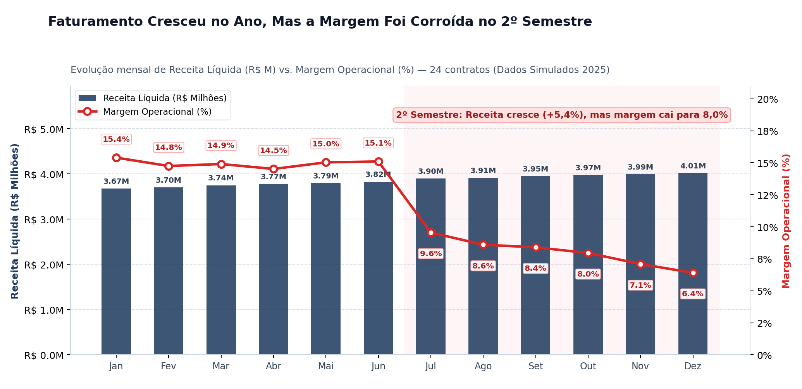
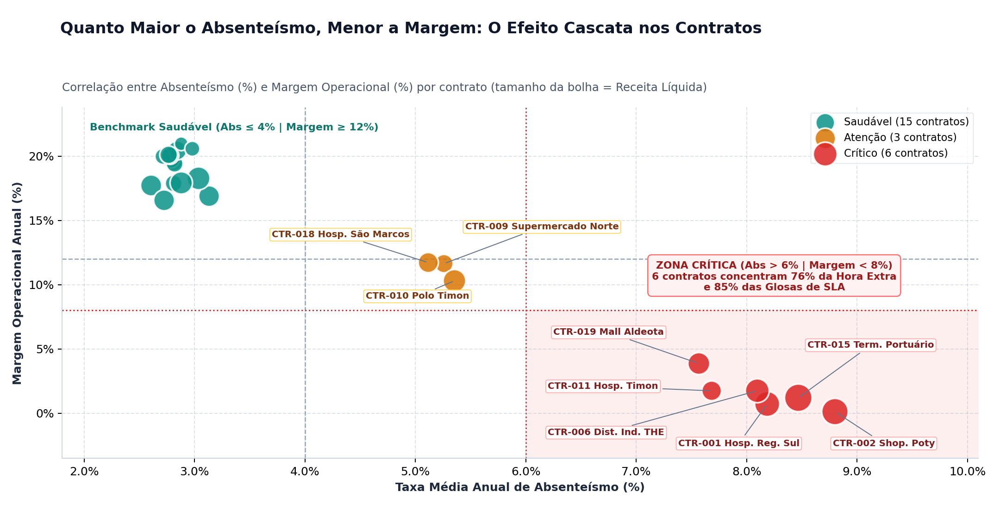

# Facilities & Outsourcing Analytics — Gestão de Margem, Absenteísmo e SLA

> **Case de Dados e Negócios** focado no setor de **prestação de serviços terceirizados e *facilities*** (Limpeza e Conservação, Segurança Privada, Atendimento/Recepção e Manutenção Predial) com atuação no Nordeste (Teresina-PI e região).  
> *Objetivo: ir além de construir gráficos — investigar o **"porquê" por trás dos números** e transformar indicadores operacionais em plano de ação financeiro para a tomada de decisão.*

> **Nota de transparência:** Todos os dados utilizados neste projeto são **100% sintéticos (simulados)** via script Python (`data/gerar_dados.py`), construídos para refletir fielmente a dinâmica real de contratos de terceirização de mão de obra e *facilities*.

---

## 1. Problema de Negócio

Em operações de terceirização e *facilities*, o faturamento bruto pode crescer mês a mês enquanto o lucro operacional encolhe silenciosamente. O desafio proposto neste estudo foi responder a três perguntas executivas sobre uma carteira simulada de **24 contratos** (média de **703 colaboradores** ao longo de **Jan–Dez/2025**):

1. **Por que a margem operacional consolidada caiu no 2º semestre mesmo com alta de receita?**
2. **Onde a rentabilidade está vazando** (hora extra de cobertura, glosas contratuais por falha de SLA ou *turnover*)?
3. **Qual o potencial financeiro recuperável** ao priorizar os contratos críticos?

---

## 2. Principais Descobertas ("O Porquê por Trás dos Números")

### A. Ilusão de Crescimento: Receita Sobe (+5,4%), Margem Despenca (-7,0 pp)

| Indicador Consolidado | 1º Semestre (S1) | 2º Semestre (S2) | Total Anual (2025) | Variação S2 vs. S1 |
| :--- | :---: | :---: | :---: | :---: |
| **Receita Líquida** | R$ 22,50M | R$ 23,72M | **R$ 46,22M** *(R$ 47,08M bruta)* | **+5,4%** |
| **Margem Operacional (R$)** | R$ 3,36M | R$ 1,89M | **R$ 5,26M** | **-43,7%** |
| **Margem Operacional (%)** | **15,0%** | **8,0%** | **11,4%** | **-7,0 pp** |
| **Taxa de Absenteísmo (%)** | 3,9% | 6,2% | **5,1%** | **+2,3 pp** |
| **Custo Hora Extra (Cobertura)** | R$ 755,8 mil | R$ 1,98M | **R$ 2,73M** | **+161,6%** |
| **Glosas Contratuais (SLA)** | R$ 223,4 mil | R$ 637,6 mil | **R$ 861,0 mil** | **+185,4%** |



### B. O Efeito Cascata do Absenteísmo e a Lei de Pareto (25% dos Contratos Explicam o Problema)

Ao abrir os números por contrato e linha de serviço, identificamos que a erosão **não é generalizada**:

- **Efeito dominó operacional:** Em postos de cobertura obrigatória (como **Segurança Privada** e **Limpeza Hospitalar/Shopping** em escalas 12x36 e noturnas), o aumento do absenteísmo de ~4% para picos de **10%–12%** no S2 força cobertura emergencial via **hora extra** (custo ~2,1x maior), derruba o **SLA abaixo de 95%** e dispara **glosas contratuais** — além de retroalimentar o *turnover* (293 desligamentos no ano; **R$ 833,0 mil** em custos de rescisão/admissão).
- **Concentração crítica:** Apenas **6 contratos críticos** (25% dos 24 contratos) concentram **76,3% de todo o custo com hora extra de cobertura** e **85,5% de todas as glosas de SLA**:
  - `CTR-002` — *Shopping Poty Center (Segurança, Teresina-PI)*: Margem anual **0,1%** (S2 **-10,7%**), Absenteísmo **8,8%**
  - `CTR-001` — *Hospital Regional Sul (Higienização, Teresina-PI)*: Margem anual **0,7%** (S2 **-9,2%**), Absenteísmo **8,2%**
  - `CTR-015` — *Terminal Portuário Ilha (Segurança Armada, São Luís-MA)*: Margem anual **1,2%** (S2 **-8,4%**), Absenteísmo **8,5%**
  - `CTR-011` — *Hospital Municipal Timon (Limpeza Técnica, Timon-MA)*: Margem anual **1,8%** (S2 **-5,6%**), Absenteísmo **7,7%**
  - `CTR-006` — *Distrito Industrial Teresina (Vigilância, Teresina-PI)*: Margem anual **1,8%** (S2 **-7,2%**), Absenteísmo **8,1%**
  - `CTR-019` — *Mall Aldeota (Limpeza & Conservação, Fortaleza-CE)*: Margem anual **3,9%** (S2 **-4,4%**), Absenteísmo **7,6%**
- **Desempenho por Linha de Serviço:** Enquanto **Atendimento e Recepção** entrega **20,0%** de margem (absenteísmo de **2,8%** e R$ 0 de glosa) e **Manutenção Predial** entrega **18,0%**, **Segurança Privada** cai para **7,1%** e **Limpeza e Conservação** para **9,9%**.



---

## 3. Plano de Ação e Impacto Financeiro Estimado

Com base no diagnóstico, três frentes práticas permitem atacar diretamente a causa raiz sem precisar renegociar preço com clientes:

1. **Implantação de Reserva Técnica / Equipe Volante Regional** (foco em Teresina/Timon e São Luís): substituir coberturas emergenciais em hora extra por folguistas dedicados nos 6 contratos críticos.
2. **Revisão de Escalas Críticas (Noturno / 12x36) e Onboarding Acelerado com RH:** atuar junto ao núcleo de atendimento ao colaborador para reduzir fadiga e *turnover* precoce nos primeiros 90 dias.
3. **Gatilho Preventivo de Gestão (Alerta Semanal):** disparar plano de contingência sempre que um contrato ultrapassar **4,5% de absenteísmo** ou cair abaixo de **95,5% de SLA**, evitando a ativação da cláusula de glosa.

> **Impacto Financeiro Estimado:** Normalizando os **6 contratos críticos** (redução conservadora de 60% nas horas extras de cobertura, eliminação de 80% das glosas de SLA e redução de 35% nos custos de *turnover*), o potencial de recuperação é de **R$ 2.020.682,16 por ano** diretamente na margem operacional.

---

## 4. Arquitetura e Ferramentas Utilizadas

```text
facilities-analytics-bi/
├── data/
│   ├── gerar_dados.py                     # Script Python determinístico (seed=42) gerador da base
│   ├── fato_operacoes.csv                 # 288 registros mensais (24 contratos x 12 meses)
│   ├── dim_contratos.csv                  # Dimensão de contratos, cidades, segmentos e metas SLA
│   └── dim_calendario.csv                 # Dimensão calendário (competências, trimestres, semestres)
├── excel/
│   ├── gerar_excel.py                     # Automação Python (openpyxl) para gerar a planilha
│   └── Analise_Operacional_Facilities.xlsx # Planilha executiva com SUMIFS, AVERAGEIFS, SE/OU e gráficos
├── powerbi/
│   ├── guia_modelo_estrela.md             # Passo a passo de ETL e relacionamentos Star Schema (1:*)
│   └── medidas_dax.md                     # Catálogo completo de medidas DAX organizadas por pasta
├── dashboard/
│   ├── index.html                         # Dashboard web interativo estilo Power BI (filtros + gráficos)
│   └── data.js                            # Base embarcada para execução instantânea offline / GitHub Pages
├── assets/
│   ├── gerar_graficos.py                  # Geração dos gráficos executivos em alta resolução
│   ├── evolucao_receita_margem.png        # Gráfico mensal Receita Líquida vs Margem %
│   └── absenteismo_vs_margem.png          # Gráfico de dispersão com quadrantes de risco
├── LINKEDIN_POST.md                       # Roteiro pronto para publicação no LinkedIn e checklist
└── README.md                              # Documentação executiva do projeto
```

### Competências Demonstradas
- **Excel Intermediário/Avançado:** Workbook estruturado em 4 abas (`Resumo_Executivo`, `Diagnostico_Contratos`, `Base_Operacoes`, `Dim_Contratos`) utilizando `SUMIFS`, `AVERAGEIFS`, `IF/OR`, `IFERROR`, formatação condicional e gráficos nativos.
- **Power BI & Modelagem Estrela:** Separação Fato/Dimensões (`1:*`), catálogo DAX com `DIVIDE`, `CALCULATE`, `FILTER`, `SUMX`, `AVERAGEX` e cálculo dinâmico de impacto financeiro.
- **Python para Dados:** Geração reprodutível de base analítica, exportação de tabelas dimensionais, automação de Excel (`openpyxl`) e visualização estatística (`pandas` + `matplotlib`).
- **Comunicação & Visão de Negócio:** Painel web responsivo e *storytelling* executivo conectando operação, RH e resultado financeiro.

---

## 5. Como Executar ou Visualizar

1. **Dashboard Web Interativo (sem instalar nada):** abra o arquivo `dashboard/index.html` no navegador (ou acesse via GitHub Pages quando publicado).
2. **Planilha Excel:** abra `excel/Analise_Operacional_Facilities.xlsx` no Microsoft Excel para testar as fórmulas e segmentações.
3. **Reproduzir os dados e artefatos via Python:**
   ```bash
   python data/gerar_dados.py
   python excel/gerar_excel.py
   python assets/gerar_graficos.py
   ```
4. **Power BI Desktop:** siga o passo a passo em [`powerbi/guia_modelo_estrela.md`](powerbi/guia_modelo_estrela.md) e cole as medidas de [`powerbi/medidas_dax.md`](powerbi/medidas_dax.md).
