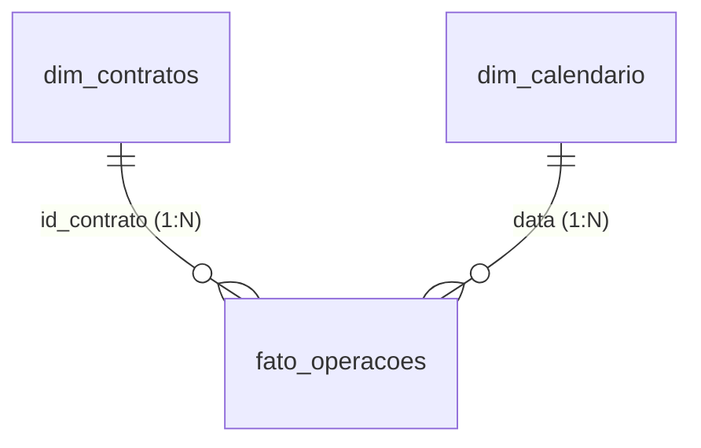

# Guia de Modelagem Estrela (Star Schema) — Power BI Desktop

Este guia mostra como montar o modelo dimensional no Power BI Desktop usando os arquivos CSV em `data/` e reproduzir o relatório executivo de 2 páginas.

---

## 1. Conexão com os Dados

No Power BI Desktop, clique em **Obter Dados > Texto/CSV** e importe os 3 arquivos:
1. `data/fato_operacoes.csv` (288 registros mensais — 24 contratos × 12 meses)
2. `data/dim_contratos.csv` (24 contratos ativos)
3. `data/dim_calendario.csv` (12 competências mensais de 2025)

### Ajustes recomendados no Power Query
- Promover a primeira linha como cabeçalho (`Promover Cabeçalhos`).
- Garantir tipos corretos:
  - `data` → **Data**
  - `headcount_previsto`, `dias_uteis`, `faltas_colaboradores`, `desligamentos`, `mes_num`, `ano` → **Número Inteiro**
  - Colunas financeiras (`receita_bruta`, `glosa_sla`, `receita_liquida`, `custo_*`, `margem_operacional`) → **Número Decimal Fixo (Moeda R$)**
  - Colunas de taxa (`*_pct`) → **Número Decimal** (formatar como `%` na camada de relatório)
- Opcional (boa prática de modelagem limpa): na tabela `fato_operacoes`, você pode remover ou ocultar as colunas descritivas redundantes (`nome_contrato`, `segmento`, `linha_servico`, `cidade`, `uf`) e utilizar exclusivamente os atributos vindos de `dim_contratos`.

---

## 2. Relacionamentos do Modelo Estrela

Na exibição **Modelo**, configure os seguintes relacionamentos (direção única `1 -> *`):

| Tabela Origem (Dimensão `1`) | Coluna Chave | Tabela Destino (Fato `*`) | Coluna Chave | Cardinalidade | Filtro Cruzado |
| :--- | :--- | :--- | :--- | :--- | :--- |
| `dim_contratos` | `id_contrato` | `fato_operacoes` | `id_contrato` | Um para muitos (`1:*`) | Único |
| `dim_calendario` | `data` | `fato_operacoes` | `data` | Um para muitos (`1:*`) | Único |

> **Dica:** Marque `dim_calendario` como **Tabela de Data** (*Ferramentas de Tabela > Marcar como tabela de data > coluna `data`*) e ordene `mes_abrev` e `mes_nome` pela coluna `mes_num` (*Classificar por coluna*).

---

## 3. Estrutura Sugerida do Relatório (2 Páginas)

### Página 1 — Visão Executiva: Receita vs. Margem
- **Segmentadores (Filtros):** `dim_contratos[linha_servico]`, `dim_contratos[cidade]`, `dim_contratos[segmento]`, `dim_calendario[semestre]`
- **Cartões de KPI (topo):**
  - `Receita Líquida`
  - `Margem Operacional R$` e `Margem Operacional %`
  - `Taxa Absenteísmo %`
  - `Custo Hora Extra Cobertura`
  - `Total Glosas SLA`
- **Visuais Principais:**
  - *Gráfico de Colunas Agrupadas e Linha:* Eixo X `dim_calendario[mes_abrev]`, Colunas `Receita Líquida`, Linha `Margem Operacional %`.
  - *Gráfico de Barras Horizontais:* `dim_contratos[linha_servico]` por `Margem Operacional %` e `Taxa Absenteísmo %`.
  - *Tabela de Ranking:* Top Contratos Críticos com formatação condicional na coluna `Status Contrato`.

### Página 2 — Causa Raiz & Plano de Recuperação
- **Gráfico de Dispersão (Scatter):**
  - Detalhes: `dim_contratos[nome_contrato]`
  - Eixo X: `Taxa Absenteísmo %`
  - Eixo Y: `Margem Operacional %`
  - Tamanho: `Receita Líquida`
  - Legenda: `Status Contrato` (ou `dim_contratos[linha_servico]`)
- **Gráfico de Rosca / Barras Empilhadas:** Composição das `Perdas por Ineficiência R$` (`Custo Hora Extra Cobertura`, `Total Glosas SLA`, `Custo Rescisão e Admissão`).
- **Cartão de Destaque (Simulação de Impacto):** `Potencial de Recuperação R$` + `% Hora Extra nos Críticos` para apoiar a tomada de decisão da diretoria de operações e RH.
